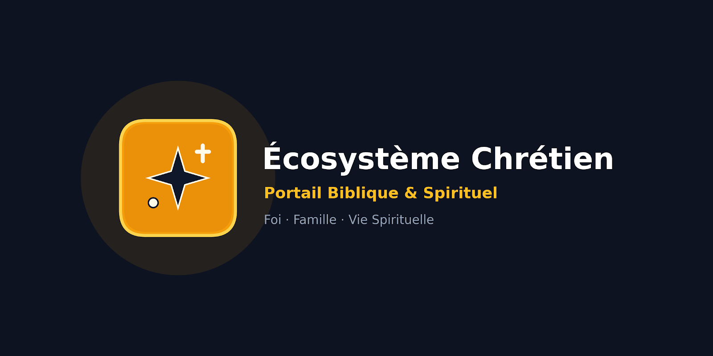

<p align="center"></p>

# Écosystème Chrétien — Portail Biblique & Spirituel

*Foi · Famille · Vie spirituelle* — application web (PWA) qui fonctionne **hors-ligne**. Textes bibliques : Louis Segond 1910. Version 7.1 — refonte de l’accueil général.

## Structure du dépôt

```
index.html                 application monopage avec accueil général et espaces dédiés
styles.css                 styles
app.js                     logique (interface, registre de prière, programme annuel, vidéos, synchronisation)
data.js                    contenus (fiches, sujets de prière, programmes, modèles) — sans aucun secret
actualites.json            flux « Actualités & Sensibilisation Chrétienne » (modifiable)
manifest.json              installation (PWA)
sw.js                      mode hors-ligne
schema_sync_supabase.sql   tables Supabase (facultatif)
icons/                     icônes et bannière
```

## Publier sur GitHub Pages en 3 étapes

1. **Créer le dépôt** : sur github.com, *New repository* (public), puis envoyer tout le contenu du dossier `app` à la **racine** du dépôt (glisser-déposer dans *Add file → Upload files*, ou `git push`).
2. **Activer Pages** : *Settings → Pages → Build and deployment → Source : « Deploy from a branch »*, branche `main`, dossier `/ (root)`, puis *Save*.
3. **Ouvrir le site** : après une minute, l'adresse `https://<ton-compte>.github.io/<nom-du-dépôt>/` est en ligne. Sur téléphone : menu du navigateur → « Installer l'application ».

> Pour tester en local : dans le dossier `app`, lancer `python -m http.server 8080` puis ouvrir <http://localhost:8080>.

## Sécurité : aucune clé dans le dépôt

- `data.js` garde `SUPABASE_URL` et `SUPABASE_ANON_KEY` **vides**. Ne les remplis pas avant de publier.
- L'URL du projet et la clé publique « anon » se saisissent dans l'application : pastille **Mode local** (en haut à droite) → **Synchronisation & sauvegardes**. Elles restent dans le `localStorage` de l'appareil.
- Une clé « service_role » ou secrète est **refusée** par l'application. Ne la colle jamais dans le dépôt ni dans l'application.
- Sans Supabase, l'application fonctionne à 100 % en **mode local** : *Exporter mes données* / *Importer un fichier* (JSON) et *points de restauration locaux*.

### Activer la synchronisation (facultatif)

1. Créer un projet sur supabase.com, puis exécuter `schema_sync_supabase.sql` dans *SQL Editor*.
2. *Authentication → Providers* : activer « Allow anonymous sign-ins » et/ou l'e-mail.
3. Dans l'application : coller l'URL et la clé « anon », puis *Enregistrer & synchroniser*. Notes, progression, fiches personnelles, programmes annuels et capsules vidéo sont synchronisés.

## Fonctions principales

| Espace / outil | Contenu |
|---|---|
| **Accueil général** | Présentation de la plateforme, accès aux cinq espaces, parole du jour et raccourcis |
| **Fille de la promesse** | Méditations, quiz, ateliers et défis |
| **Génération Lumière** | Jeunesse : vocation, relations, discernement, famille, cité |
| **Source de vie** | 66 prières : Prière Générale, Bénédictions, puis 9 rubriques de délivrance (moments difficiles, paix, délivrance, combat spirituel, protection, matin & soir, guérison, réussite, gratitude) + synchronisation optionnelle prieredelivrance.com |
| **Élan Famille** | 383 sujets de prière : enfants, **Prière Générale**, **Prière pour les Bénédictions**, parents, encadreurs |
| **Fondement vie spirituelle** | Don, autels, alliances, consécration, monde numérique |
| **Source de vie** | 66 sujets de prière et ressources de prière |
| **Programme annuel d'activités** | Tableau de 12 mois, modifiable cellule par cellule, multi-années, duplication, export JSON, impression |
| **Capsules vidéo de sensibilisation** | 5 thèmes, lecteur YouTube / MP4, ajout et modification des liens |
| **Actualités & Ressources du jour** | Flux `actualites.json`, titres de sites chrétiens, verset et sujets de prière du jour |
| **Registre de prière** | Les noms remplacent `{PRENOM}` dans toutes les prières ; bouton *Effacer* pour revenir à `{PRENOM}` |

Chaque espace affiche trois cartes : **Conseil pratique**, **Point de Vigilance & Alerte**, **Recommandation**.

## Actualiser les contenus

- **Actualités & Sensibilisation** : modifier `actualites.json` (champs `categorie`, `titre`, `texte`, `verset`, `lien`) ou indiquer une autre adresse dans *Changer la source du flux*.
- **Programme annuel** : cliquer sur une cellule pour la modifier ; *Dupliquer et actualiser pour la nouvelle année* copie l'année en cours vers la suivante (statuts remis à « Planifié »).
- **Vidéos** : *Gérer les capsules* → coller un lien `https://` YouTube ou un fichier `.mp4`. Les capsules livrées n'ont volontairement aucun lien : ajoute les tiens après les avoir visionnées.
- **Illustrations** : des visuels SVG sont intégrés (fonctionnent hors-ligne). Pour utiliser des photos, renseigner `IMAGES` dans `window.APP_CONFIG` (`data.js`), par exemple `{ P2: "https://…", prog: "https://…", videos: "https://…" }` ; en cas d'échec, le SVG s'affiche.

## Bon usage

Les textes de prière et d'édification sont des aides à la méditation ; ils ne remplacent ni la lecture de la Bible, ni l'accompagnement d'un responsable d'Église. Pour les mineurs : toujours deux adultes responsables et l'accord écrit des parents (sorties, photos, vidéos).


## Refonte V7.1 — accueil général

- L'application ouvre désormais sur un accueil général au premier lancement après mise à jour.
- Les cinq espaces sont présentés sur la page d'accueil avec leurs volumes de ressources.
- Le verset du jour est sélectionné à partir des ressources bibliques déjà présentes dans les données.
- La barre mobile est limitée à cinq entrées ; les autres espaces restent accessibles dans le menu latéral.
- Les libellés de confidentialité ont été clarifiés : les données restent locales sauf activation volontaire de la synchronisation Supabase.
- Le cache du service worker est versionné en `ec-v10.22.0`.

### Volumes constatés dans `data.js`

| Espace | Ressources présentes |
|---|---:|
| P1 — Fille de la promesse | 42 |
| P2 — Élan Famille | 383 |
| P3 — Fondement vie spirituelle | 31 |
| P4 — Génération Lumière | 10 |
| P5 — Source de vie | 66 |
| **Total** | **532** |

Ces nombres sont des enregistrements présents dans le fichier de données fourni, pas une mesure d'utilisation.

## V7.2 — audit fonctionnel et sécurité

- Rapport complémentaire : `../AUDIT_SECURITE_V7_2.md`.
- Tests de cohérence des données : depuis `app/`, exécuter `node --test tests/data-integrity.test.js`.
- Les notes synchronisées dans Supabase sont isolées par RLS mais ne sont pas chiffrées de bout en bout.
- `gemini-code-1795077143555.sql` est désormais neutralisé : ne pas exécuter d'ancienne version de cette migration permissive.
- `gemini-code-1794842150852.sql` est un brouillon de modèle métier, non validé pour une mise en production.

## V8 — architecture centrale de préproduction

Le dossier parent contient désormais :
- `database/migrations/001_platform_core.sql` : socle central additif (profils minimaux, rôles, églises, contributions, versions éditoriales, modération, signalements et journal d'audit) ;
- `database/tests/RLS_ACCEPTANCE_MATRIX.md` : matrice de tests à exécuter avec plusieurs comptes sur Supabase de préproduction ;
- `docs/ARCHITECTURE_CIBLE_V1.md` : architecture logique, rôles, frontières de confidentialité et stratégie de migration ;
- `docs/PLAN_LIVRAISON_ET_RECETTE.md` : critères de recette et limites de la livraison.

Depuis le dossier `app/`, lancer toute la suite locale :

```bash
node --test tests/*.test.js
```

**Attention :** la migration V8 n'a pas été exécutée sur Supabase. Elle doit être relue, déployée sur un projet de préproduction et soumise à la matrice RLS avant toute donnée réelle. Elle ne crée pas encore les écrans de compte, le portail d'administration, le workflow transactionnel complet ni l'application Android native.
